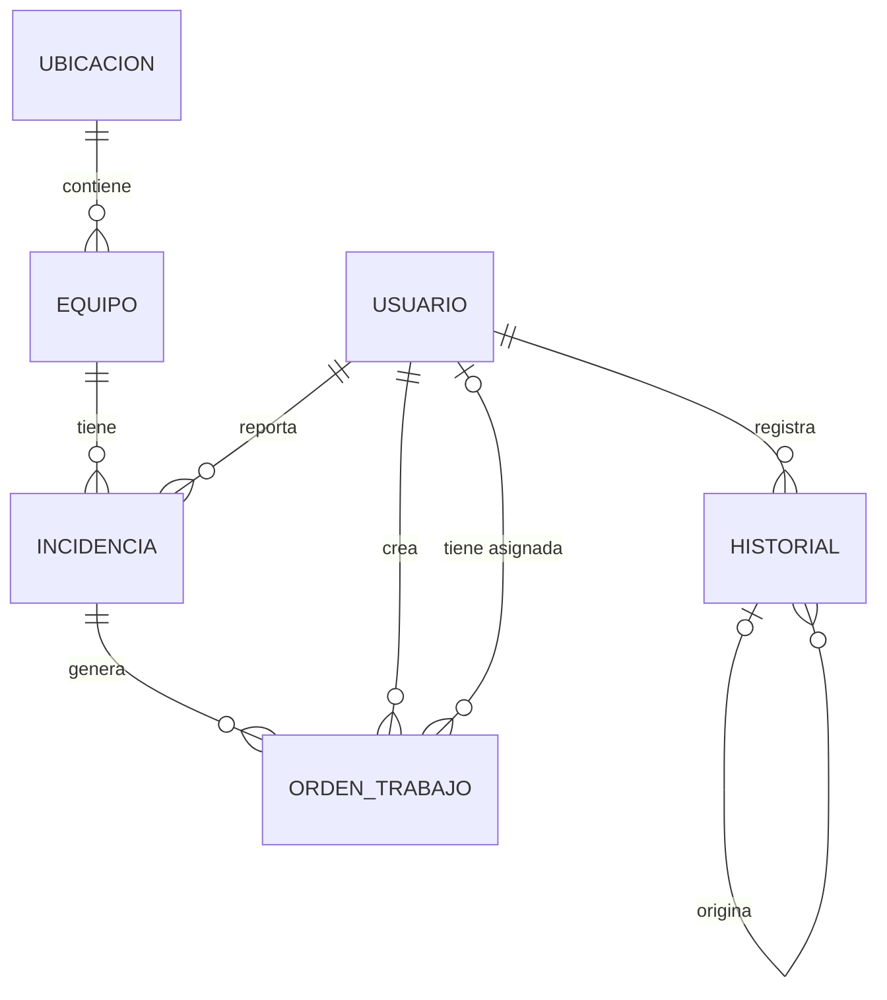
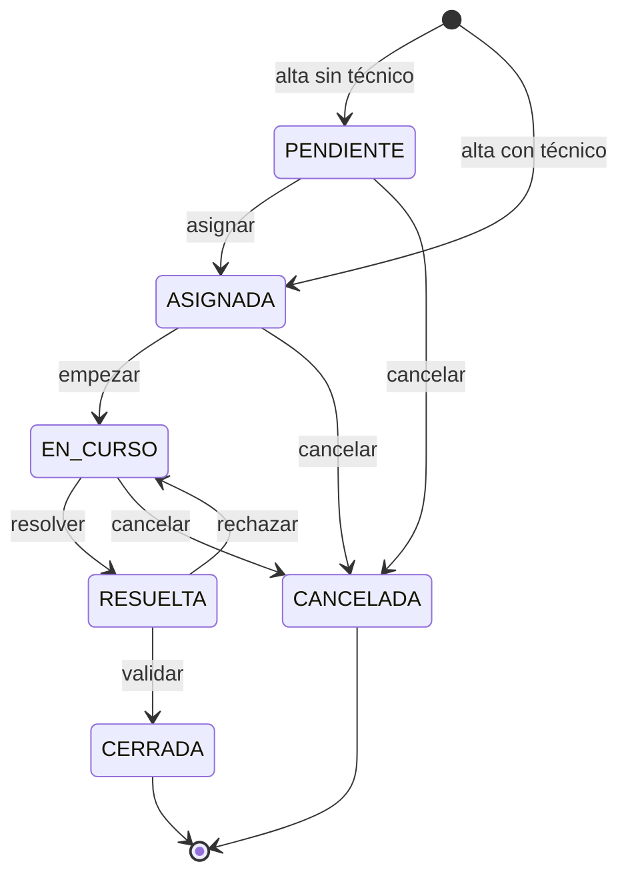
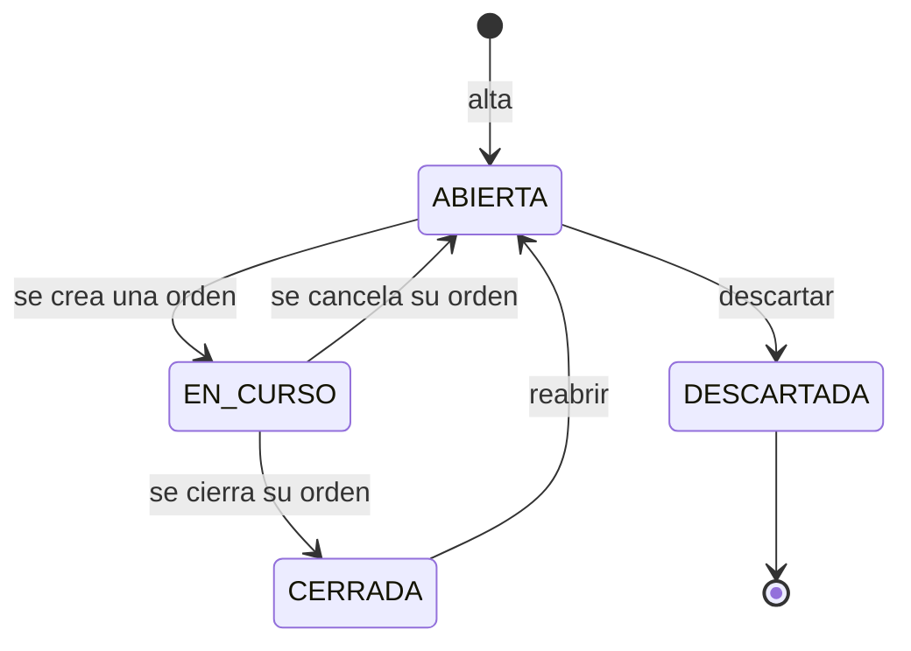

# Mantix — Especificación del MVP

Oct 18, 2026 · @Carlos

Contrato del backend (`mantix-backend`) para el MVP. Responde a las seis preguntas de la [guía](Guía.md); el backend no se empieza hasta que estén todas cerradas. Las decisiones que salen de aquí se anotan en [decisiones.md](decisiones.md).

## 1. Modelo de datos

Seis entidades. Los nombres de tabla y columna van en `snake_case`. Los enums se guardan como `VARCHAR` (`@Enumerated(EnumType.STRING)`) y no como `ENUM` de MySQL, para poder añadir valores sin migrar el tipo de columna.



Todas las tablas tienen `id BIGINT` autoincremental como clave primaria.

### Usuario (`usuario`)

| Columna  | Tipo           | Restricciones                    |
| -------- | -------------- | -------------------------------- |
| `nombre` | `VARCHAR(100)` | obligatorio                      |
| `email`  | `VARCHAR(150)` | obligatorio, único               |
| `perfil` | `VARCHAR(20)`  | obligatorio: `TECNICO`, `RESPONSABLE` |
| `activo` | `BOOLEAN`      | obligatorio, por defecto `true`  |

Sin contraseña en el MVP: el usuario se elige con un selector simulado. El login real llega en la fase 2.

### Ubicación (`ubicacion`)

| Columna       | Tipo           | Restricciones      |
| ------------- | -------------- | ------------------ |
| `nombre`      | `VARCHAR(100)` | obligatorio, único |
| `descripcion` | `VARCHAR(255)` | opcional           |

Lista plana (p. ej. «Planta 1 – Zona A»). Si más adelante hace falta una jerarquía, se añade `ubicacion_padre_id`.

### Equipo (`equipo`)

| Columna        | Tipo           | Restricciones                                  |
| -------------- | -------------- | ---------------------------------------------- |
| `codigo`       | `VARCHAR(20)`  | obligatorio, único (p. ej. `BOM-001`)          |
| `nombre`       | `VARCHAR(100)` | obligatorio                                    |
| `fabricante`   | `VARCHAR(100)` | opcional                                       |
| `modelo`       | `VARCHAR(100)` | opcional                                       |
| `numero_serie` | `VARCHAR(100)` | opcional                                       |
| `ubicacion_id` | `BIGINT`       | obligatorio, FK → `ubicacion`                  |
| `estado`       | `VARCHAR(20)`  | obligatorio: `OPERATIVO`, `AVERIADO`, `BAJA`; por defecto `OPERATIVO` |
| `fecha_alta`   | `DATE`         | obligatorio                                    |

Un equipo no se borra: se da de baja (`BAJA`) para conservar sus incidencias. Sus cambios de estado también quedan en el historial. Cuándo cambia de estado se define en las reglas de negocio (RN-10 a RN-14).

### Incidencia (`incidencia`)

| Columna            | Tipo           | Restricciones                                     |
| ------------------ | -------------- | ------------------------------------------------- |
| `equipo_id`        | `BIGINT`       | obligatorio, FK → `equipo`                        |
| `reportada_por_id` | `BIGINT`       | obligatorio, FK → `usuario`                       |
| `titulo`           | `VARCHAR(150)` | obligatorio                                       |
| `descripcion`      | `TEXT`         | obligatorio                                       |
| `prioridad`        | `VARCHAR(20)`  | obligatorio: `BAJA`, `MEDIA`, `ALTA`, `CRITICA`   |
| `estado`           | `VARCHAR(20)`  | obligatorio (valores en el apartado 2)            |
| `fecha_apertura`   | `DATETIME`     | obligatorio                                       |
| `fecha_cierre`     | `DATETIME`     | opcional; se rellena al cerrarla                  |

### Orden de trabajo (`orden_trabajo`)

| Columna          | Tipo       | Restricciones                                       |
| ---------------- | ---------- | --------------------------------------------------- |
| `incidencia_id`  | `BIGINT`   | obligatorio, FK → `incidencia`                      |
| `creada_por_id`  | `BIGINT`   | obligatorio, FK → `usuario` (responsable)           |
| `tecnico_id`     | `BIGINT`   | opcional hasta asignarla, FK → `usuario` (técnico)  |
| `descripcion`    | `TEXT`     | obligatorio: trabajo que hay que hacer              |
| `resolucion`     | `TEXT`     | opcional; obligatorio al resolverla                 |
| `estado`         | `VARCHAR(20)` | obligatorio (valores en el apartado 2)           |
| `fecha_creacion` | `DATETIME` | obligatorio                                         |
| `fecha_inicio`   | `DATETIME` | opcional; se rellena al empezar el trabajo          |
| `fecha_fin`      | `DATETIME` | opcional; se rellena al resolverla                  |

- Una incidencia puede tener **varias órdenes**, pero solo **una sin cerrar** a la vez. MySQL no tiene índices únicos parciales, así que la restricción la garantiza el servicio (se formaliza en las reglas de negocio).
- La orden no guarda el equipo: se obtiene a través de su incidencia, para no duplicar el dato.

### Historial (`historial`)

| Columna          | Tipo          | Restricciones                                                                   |
| ---------------- | ------------- | ------------------------------------------------------------------------------- |
| `tipo_entidad`   | `VARCHAR(20)` | obligatorio: `EQUIPO`, `INCIDENCIA`, `ORDEN`                                    |
| `entidad_id`     | `BIGINT`      | obligatorio: id del equipo, la incidencia o la orden                            |
| `accion`         | `VARCHAR(30)` | obligatorio: `ALTA`, `CAMBIO_ESTADO`, `CAMBIO_PRIORIDAD`, `CAMBIO_TECNICO`      |
| `valor_anterior` | `VARCHAR(50)` | opcional (vacío en `ALTA` y en la primera asignación de técnico)               |
| `valor_nuevo`    | `VARCHAR(50)` | obligatorio                                                                     |
| `origen_id`      | `BIGINT`      | opcional, FK → `historial`: fila principal de la acción que provocó esta        |
| `usuario_id`     | `BIGINT`      | obligatorio, FK → `usuario`                                                     |
| `fecha`          | `DATETIME`    | obligatorio, en UTC                                                             |
| `comentario`     | `TEXT`        | opcional (cuándo es obligatorio: reglas de negocio)                             |

Índice en (`tipo_entidad`, `entidad_id`, `fecha`) para leer el historial de una entidad en orden.

Tabla **polimórfica**: una sola tabla para todas las entidades y todos los tipos de cambio. Para registrar una entidad nueva (p. ej. el mantenimiento preventivo de la fase 3) o un tipo de cambio nuevo, basta con añadir un valor a `tipo_entidad` o a `accion`, sin migraciones. A cambio, `entidad_id` no es una clave foránea real: es `HistorialService` quien garantiza que apunta a una entidad que existe, y el historial solo se escribe desde ese servicio. Qué se escribe en cada acción se detalla en el apartado 4.

## 2. Estados y transiciones

La orden de trabajo lleva el flujo; la incidencia cambia casi siempre de forma automática, como consecuencia de su orden. Cualquier transición que no aparezca en las tablas está prohibida, y la API la rechaza.

Las transiciones automáticas se registran en el historial a nombre del usuario que hizo la acción que las provocó.

### Orden de trabajo



| Desde       | Hacia       | Acción   | Quién               | Condición                                                    |
| ----------- | ----------- | -------- | ------------------- | ------------------------------------------------------------ |
| —           | `PENDIENTE` | alta     | responsable         | La incidencia no tiene otra orden sin cerrar                 |
| —           | `ASIGNADA`  | alta     | responsable         | Igual que la anterior, pero se indica ya el técnico          |
| `PENDIENTE` | `ASIGNADA`  | asignar  | responsable         | Se indica un técnico activo                                  |
| `ASIGNADA`  | `EN_CURSO`  | empezar  | el técnico asignado | Se rellena `fecha_inicio`                                    |
| `EN_CURSO`  | `RESUELTA`  | resolver | el técnico asignado | `resolucion` obligatoria; se rellena `fecha_fin`             |
| `RESUELTA`  | `CERRADA`   | validar  | responsable         | —                                                            |
| `RESUELTA`  | `EN_CURSO`  | rechazar | responsable         | Comentario obligatorio con el motivo; se vacía `fecha_fin`   |
| `PENDIENTE` | `CANCELADA` | cancelar | responsable         | Comentario obligatorio con el motivo                         |
| `ASIGNADA`  | `CANCELADA` | cancelar | responsable         | Comentario obligatorio con el motivo                         |
| `EN_CURSO`  | `CANCELADA` | cancelar | responsable         | Comentario obligatorio con el motivo                         |

- `CERRADA` y `CANCELADA` son estados finales: una orden no se reabre. Si la avería vuelve, se reabre la incidencia y se crea una orden nueva.
- Solo el responsable asigna. Un técnico no puede asignarse una orden él mismo.
- Mientras la orden está `ASIGNADA`, el responsable puede cambiar de técnico. El estado no cambia; en el historial queda como `CAMBIO_TECNICO`.

### Incidencia



| Desde      | Hacia        | Acción              | Quién       | Condición                                              |
| ---------- | ------------ | ------------------- | ----------- | ------------------------------------------------------ |
| —          | `ABIERTA`    | alta                | cualquiera  | El equipo no está de `BAJA`; se rellena `fecha_apertura` |
| `ABIERTA`  | `EN_CURSO`   | automática          | —           | Al crear una orden para la incidencia                  |
| `EN_CURSO` | `ABIERTA`    | automática          | —           | Al cancelar su orden activa                            |
| `EN_CURSO` | `CERRADA`    | automática          | —           | Al cerrar su orden activa; se rellena `fecha_cierre`   |
| `ABIERTA`  | `DESCARTADA` | descartar           | responsable | Comentario obligatorio (falsa alarma, duplicada…)      |
| `CERRADA`  | `ABIERTA`    | reabrir             | responsable | Comentario obligatorio con el motivo; se vacía `fecha_cierre` |

- `DESCARTADA` es un estado final.
- Solo se puede crear una orden si la incidencia está `ABIERTA`.
- Cerrar la orden cierra la incidencia: el responsable valida una sola vez.

### Equipo

| Desde       | Hacia       | Acción     | Quién       | Condición                                                 |
| ----------- | ----------- | ---------- | ----------- | --------------------------------------------------------- |
| —           | `OPERATIVO` | alta       | responsable | Código único                                              |
| `OPERATIVO` | `AVERIADO`  | automática | —           | Tiene una incidencia `CRITICA` sin cerrar (RN-10)         |
| `AVERIADO`  | `OPERATIVO` | automática | —           | Ya no le queda ninguna incidencia `CRITICA` sin cerrar (RN-11) |
| `OPERATIVO` | `BAJA`      | dar de baja | responsable | Sin incidencias sin cerrar; motivo obligatorio (RN-12)   |
| `BAJA`      | `OPERATIVO` | reactivar  | responsable | Motivo obligatorio (RN-13)                                |

Un equipo `AVERIADO` no se puede dar de baja: tiene, por definición, una incidencia sin cerrar.

## 3. Reglas de negocio

Cada regla tiene un identificador para citarla en los tests (`@DisplayName("RN-07 …")`) y en los errores de la API. Una acción que incumple una regla se rechaza entera: no cambia nada, ni siquiera el historial.

Vocabulario:

- **Incidencia sin cerrar:** en estado `ABIERTA` o `EN_CURSO`.
- **Orden sin cerrar:** en estado `PENDIENTE`, `ASIGNADA`, `EN_CURSO` o `RESUELTA`.
- **Motivo obligatorio:** comentario no vacío (sin contar espacios) de 500 caracteres como máximo.

### Generales

| ID    | Regla                                                                                                                                                  |
| ----- | ------------------------------------------------------------------------------------------------------------------------------------------------------ |
| RN-01 | Solo se permiten las transiciones de estado que aparecen en el apartado 2; cualquier otra se rechaza.                                                 |
| RN-02 | Cada alta y cada cambio de estado, prioridad o técnico, incluidos los automáticos, escribe su fila en el historial en la misma transacción. Si falla algo, no se guarda nada (apartado 4). |
| RN-03 | El historial no se modifica ni se borra.                                                                                                               |

### Usuarios y perfiles

| ID    | Regla                                                                                                                                                           |
| ----- | --------------------------------------------------------------------------------------------------------------------------------------------------------------- |
| RN-04 | Solo un usuario activo puede hacer acciones o recibir órdenes.                                                                                                  |
| RN-05 | Están reservadas al responsable: el alta y la edición de equipos, la baja y la reactivación, el alta y la asignación de órdenes, la reasignación, la validación, el rechazo y la cancelación, el descarte y la reapertura de incidencias, y el cambio de prioridad. |
| RN-06 | Solo el técnico asignado a una orden puede empezarla y resolverla.                                                                                              |
| RN-07 | Una orden solo se puede asignar a un usuario con perfil `TECNICO`.                                                                                             |
| RN-08 | Usuarios y ubicaciones se cargan con la migración de datos iniciales; en el MVP la API solo los lee.                                                           |

### Equipos

| ID    | Regla                                                                                                                                                            |
| ----- | ---------------------------------------------------------------------------------------------------------------------------------------------------------------- |
| RN-09 | El código del equipo es único y no se puede cambiar después del alta.                                                                                            |
| RN-10 | Un equipo `OPERATIVO` pasa automáticamente a `AVERIADO` cuando tiene una incidencia `CRITICA` sin cerrar: al abrirla, al reabrirla o al subirle la prioridad a `CRITICA`.             |
| RN-11 | Un equipo `AVERIADO` vuelve automáticamente a `OPERATIVO` cuando ya no le queda ninguna incidencia `CRITICA` sin cerrar: al cerrarla, al descartarla o al bajarle la prioridad. |
| RN-12 | Solo se puede dar de baja un equipo `OPERATIVO` que no tenga incidencias sin cerrar. El motivo es obligatorio.                                                  |
| RN-13 | Un equipo de `BAJA` se puede reactivar (`BAJA` → `OPERATIVO`). El motivo es obligatorio.                                                                        |
| RN-14 | Un equipo de `BAJA` no se edita ni admite incidencias nuevas.                                                                                                   |

### Incidencias

| ID    | Regla                                                                                                                                  |
| ----- | -------------------------------------------------------------------------------------------------------------------------------------- |
| RN-15 | La prioridad solo se cambia mientras la incidencia está sin cerrar, y se vuelve a evaluar el estado del equipo (RN-10, RN-11).         |
| RN-16 | Para descartar una incidencia, tiene que estar `ABIERTA`. El motivo es obligatorio.                                                    |
| RN-17 | Para reabrir una incidencia, tiene que estar `CERRADA`. El motivo es obligatorio. Las descartadas no se reabren.                       |
| RN-18 | La incidencia pasa a `EN_CURSO`, vuelve a `ABIERTA` o se cierra automáticamente cuando su orden se crea, se cancela o se cierra; esos cambios no se pueden hacer a mano. |

### Órdenes de trabajo

| ID    | Regla                                                                                                    |
| ----- | -------------------------------------------------------------------------------------------------------- |
| RN-19 | Solo se puede crear una orden para una incidencia `ABIERTA`.                                             |
| RN-20 | Una incidencia tiene, como mucho, una orden sin cerrar.                                                  |
| RN-21 | Para resolver una orden hay que escribir la resolución (texto no vacío).                                 |
| RN-22 | Rechazar una resolución o cancelar una orden exige un motivo.                                            |
| RN-23 | Una orden `CERRADA` o `CANCELADA` no cambia más.                                                         |
| RN-24 | Solo se cambia de técnico mientras la orden está `ASIGNADA`. El nuevo técnico es distinto del actual y cumple RN-04 y RN-07. |

RN-19 y RN-20 se solapan: si la incidencia está `ABIERTA`, no tiene ninguna orden sin cerrar. Se mantienen las dos para que la segunda tenga su propio test y no dependa de que la máquina de estados no tenga fallos.

## 4. Trazabilidad

El historial responde a cinco preguntas sobre cada cambio: qué entidad cambió, qué cambió (de qué valor a qué valor), quién lo hizo, cuándo y por qué (comentario u origen).

### Qué se registra

| `accion`           | Entidades                     | `valor_anterior` → `valor_nuevo`                 |
| ------------------ | ----------------------------- | ------------------------------------------------ |
| `ALTA`             | equipo, incidencia, orden     | vacío → estado inicial                           |
| `CAMBIO_ESTADO`    | equipo, incidencia, orden     | estado → estado                                  |
| `CAMBIO_PRIORIDAD` | incidencia                    | prioridad → prioridad                            |
| `CAMBIO_TECNICO`   | orden                         | id del técnico (vacío la primera vez) → id del técnico |

No se registran las ediciones de los datos descriptivos del equipo (nombre, fabricante, modelo, número de serie, ubicación). Si hicieran falta, se añadiría la acción `EDICION` con el nombre del campo.

### Acción principal y consecuencias

Una acción del usuario puede escribir varias filas. La primera es la **fila principal** (`origen_id` vacío). Las demás son **consecuencias**: cambios automáticos o complementarios que apuntan a la principal con `origen_id`. Todas comparten usuario y fecha.

Así se puede responder, por ejemplo, a «¿por qué se cerró la incidencia 5?»: su fila `CAMBIO_ESTADO` → `CERRADA` tiene como origen el cierre de la orden 12.

| Acción del usuario         | Fila principal                                     | Consecuencias (con `origen_id`)                                                         |
| -------------------------- | -------------------------------------------------- | --------------------------------------------------------------------------------------- |
| Alta de equipo             | equipo `ALTA` → `OPERATIVO`                        | —                                                                                       |
| Baja / reactivación        | equipo `CAMBIO_ESTADO` (con motivo)                | —                                                                                       |
| Alta de incidencia         | incidencia `ALTA` → `ABIERTA`                      | Si es `CRITICA`: equipo `OPERATIVO` → `AVERIADO`                                        |
| Cambio de prioridad        | incidencia `CAMBIO_PRIORIDAD`                      | Si cambia el estado del equipo: equipo `CAMBIO_ESTADO`                                  |
| Descartar incidencia       | incidencia `ABIERTA` → `DESCARTADA` (con motivo)   | Si era la última `CRITICA`: equipo `AVERIADO` → `OPERATIVO`                             |
| Reabrir incidencia         | incidencia `CERRADA` → `ABIERTA` (con motivo)      | Si es `CRITICA`: equipo `OPERATIVO` → `AVERIADO`                                        |
| Alta de orden              | orden `ALTA` → `PENDIENTE` o `ASIGNADA`            | Si lleva técnico: orden `CAMBIO_TECNICO`. Siempre: incidencia `ABIERTA` → `EN_CURSO`    |
| Asignar                    | orden `PENDIENTE` → `ASIGNADA`                     | orden `CAMBIO_TECNICO`                                                                  |
| Reasignar                  | orden `CAMBIO_TECNICO`                             | —                                                                                       |
| Empezar                    | orden `ASIGNADA` → `EN_CURSO`                      | —                                                                                       |
| Resolver                   | orden `EN_CURSO` → `RESUELTA` (comentario = resolución) | —                                                                                  |
| Rechazar                   | orden `RESUELTA` → `EN_CURSO` (con motivo)         | —                                                                                       |
| Validar                    | orden `RESUELTA` → `CERRADA`                       | incidencia `EN_CURSO` → `CERRADA`; si era la última `CRITICA`: equipo `AVERIADO` → `OPERATIVO` |
| Cancelar                   | orden → `CANCELADA` (con motivo)                   | incidencia `EN_CURSO` → `ABIERTA`                                                       |

Al resolver, el texto de la resolución se copia en el comentario de la fila. Si el responsable la rechaza y el técnico vuelve a resolver, `orden_trabajo.resolucion` guarda solo la última, pero el historial conserva todas.

### Quién y cuándo

- **Quién:** el usuario que hace la acción, también en las consecuencias automáticas. En el MVP es el usuario elegido en el selector simulado; en la fase 2, el usuario autenticado.
- **Cuándo:** la fecha la pone el servidor, en UTC (`hibernate.jdbc.time_zone: UTC`). El cliente nunca la envía, y el frontend la muestra en la hora local.
- Las fechas de la propia entidad (`fecha_inicio`, `fecha_fin`, `fecha_cierre`…) son un acceso directo al estado actual. La fuente de verdad es el historial.

## 5. API

### Convenciones

- Prefijo `/api`. Peticiones y respuestas en JSON, con los campos en `camelCase`.
- **Usuario:** las peticiones que modifican datos (`POST`, `PUT`) llevan la cabecera `X-Usuario-Id: <id>`, que el frontend toma del selector simulado. Las lecturas no la necesitan. En la fase 2, Spring Security sustituirá la cabecera sin cambiar los endpoints ni los cuerpos.
- **Cambios de estado:** un endpoint `POST` por acción (`/api/ordenes/{id}/validar`), con los mismos nombres que las acciones del apartado 2. Nunca se cambia el estado con `PUT`.
- **Fechas y horas:** ISO-8601 en UTC (`2026-10-18T09:30:00Z`). Fechas sin hora: `2026-10-18`.
- **Respuestas:** un alta devuelve `201 Created` con la cabecera `Location` y la entidad creada. Una acción o una edición devuelve `200 OK` con la entidad actualizada.
- **Listados:** devuelven un array completo, sin paginar (la paginación llega en la fase 2). Los filtros van como parámetros de consulta opcionales y se combinan con Y.
- En el MVP no hace falta CORS: el frontend llama a la API a través del proxy de Vite.

### Errores

Todos los errores siguen el formato `ProblemDetail` (RFC 9457) de Spring, con `Content-Type: application/problem+json` y dos campos propios:

- `codigo`: identifica el error. Si se ha incumplido una regla, es su `RN-xx`.
- `errores`: solo en los errores de validación, una entrada por campo.

```json
{
  "type": "about:blank",
  "title": "Regla de negocio incumplida",
  "status": 409,
  "detail": "La incidencia 5 ya tiene una orden sin cerrar (orden 12).",
  "instance": "/api/ordenes",
  "codigo": "RN-20"
}
```

```json
{
  "title": "Datos no válidos",
  "status": 400,
  "detail": "La petición tiene campos no válidos.",
  "instance": "/api/ordenes/12/cancelar",
  "codigo": "VALIDACION",
  "errores": [{ "campo": "comentario", "mensaje": "El motivo es obligatorio" }]
}
```

| Estado | `codigo`                  | Cuándo                                                                                       |
| ------ | ------------------------- | -------------------------------------------------------------------------------------------- |
| 400    | `VALIDACION`              | Cuerpo mal formado, campo obligatorio vacío, longitud o enum no válidos (incluye los motivos obligatorios) |
| 401    | `USUARIO_NO_IDENTIFICADO` | Falta `X-Usuario-Id` o no corresponde a ningún usuario                                       |
| 403    | `RN-04` a `RN-07`         | Usuario inactivo, perfil sin permiso o técnico que no es el asignado                         |
| 404    | `NO_ENCONTRADO`           | El recurso de la ruta, o un id del cuerpo (`equipoId`, `tecnicoId`…), no existe              |
| 409    | `RN-01`, `RN-09`…         | La acción no está permitida en el estado actual o incumple otra regla de negocio             |
| 500    | `ERROR_INTERNO`           | Error no previsto; el detalle va al log, nunca a la respuesta                                |

### Objetos de respuesta

Las entidades relacionadas aparecen resumidas como `{ "id", "nombre" }` (equipos: `{ "id", "codigo", "nombre" }`), para que el frontend no tenga que hacer peticiones extra.

**`Usuario`**

```json
{ "id": 2, "nombre": "Ana Ruiz", "email": "ana@mantix.local", "perfil": "TECNICO", "activo": true }
```

**`Ubicacion`**

```json
{ "id": 1, "nombre": "Planta 1 – Zona A", "descripcion": "Línea de envasado" }
```

**`Equipo`**

```json
{
  "id": 7, "codigo": "BOM-001", "nombre": "Bomba de agua principal",
  "fabricante": "Grundfos", "modelo": "CR 10", "numeroSerie": "A1234",
  "ubicacion": { "id": 1, "nombre": "Planta 1 – Zona A" },
  "estado": "OPERATIVO", "fechaAlta": "2026-10-18"
}
```

**`Incidencia`**: el detalle (`GET /api/incidencias/{id}`) añade `ordenes`, con todas sus órdenes resumidas.

```json
{
  "id": 5, "equipo": { "id": 7, "codigo": "BOM-001", "nombre": "Bomba de agua principal" },
  "titulo": "Fuga en el sello", "descripcion": "Gotea agua por el eje.",
  "prioridad": "ALTA", "estado": "EN_CURSO",
  "reportadaPor": { "id": 2, "nombre": "Ana Ruiz" },
  "fechaApertura": "2026-10-18T09:30:00Z", "fechaCierre": null,
  "ordenActivaId": 12,
  "ordenes": [{ "id": 12, "estado": "ASIGNADA", "tecnico": { "id": 2, "nombre": "Ana Ruiz" }, "fechaCreacion": "2026-10-18T10:00:00Z" }]
}
```

**`Orden`**

```json
{
  "id": 12, "incidencia": { "id": 5, "titulo": "Fuga en el sello" },
  "equipo": { "id": 7, "codigo": "BOM-001", "nombre": "Bomba de agua principal" },
  "descripcion": "Cambiar el sello mecánico.", "resolucion": null, "estado": "ASIGNADA",
  "creadaPor": { "id": 1, "nombre": "Luis Gómez" }, "tecnico": { "id": 2, "nombre": "Ana Ruiz" },
  "fechaCreacion": "2026-10-18T10:00:00Z", "fechaInicio": null, "fechaFin": null
}
```

**`EntradaHistorial`**: en `CAMBIO_TECNICO`, los valores son ids de usuario, y el frontend los traduce con la lista de usuarios.

```json
{
  "id": 40, "tipoEntidad": "INCIDENCIA", "entidadId": 5, "accion": "CAMBIO_ESTADO",
  "valorAnterior": "EN_CURSO", "valorNuevo": "CERRADA", "origenId": 39,
  "usuario": { "id": 1, "nombre": "Luis Gómez" },
  "fecha": "2026-10-18T12:00:00Z", "comentario": null
}
```

### Usuarios y ubicaciones (solo lectura, RN-08)

| Método | Ruta                  | Filtros            | Respuesta     |
| ------ | --------------------- | ------------------ | ------------- |
| GET    | `/api/usuarios`       | `perfil`, `activo` | `Usuario[]`   |
| GET    | `/api/usuarios/{id}`  | —                  | `Usuario`     |
| GET    | `/api/ubicaciones`    | —                  | `Ubicacion[]` |

### Equipos

| Método | Ruta                            | Cuerpo                                                                         | Respuesta            | Reglas            |
| ------ | ------------------------------- | ------------------------------------------------------------------------------ | -------------------- | ----------------- |
| GET    | `/api/equipos`                  | Filtros: `estado`, `ubicacionId`, `q` (busca en código y nombre)               | `Equipo[]`           | —                 |
| GET    | `/api/equipos/{id}`             | —                                                                              | `Equipo`             | —                 |
| POST   | `/api/equipos`                  | `codigo`\*, `nombre`\*, `ubicacionId`\*, `fabricante`, `modelo`, `numeroSerie`, `fechaAlta` (por defecto, hoy) | 201 `Equipo` | RN-05, RN-09 |
| PUT    | `/api/equipos/{id}`             | `nombre`\*, `ubicacionId`\*, `fabricante`, `modelo`, `numeroSerie` (el código no se envía) | `Equipo`  | RN-05, RN-14      |
| POST   | `/api/equipos/{id}/baja`        | `comentario`\*                                                                 | `Equipo`             | RN-05, RN-12      |
| POST   | `/api/equipos/{id}/reactivar`   | `comentario`\*                                                                 | `Equipo`             | RN-05, RN-13      |
| GET    | `/api/equipos/{id}/historial`   | —                                                                              | `EntradaHistorial[]` | —                 |

\* obligatorio.

### Incidencias

| Método | Ruta                                | Cuerpo                                                 | Respuesta            | Reglas              |
| ------ | ----------------------------------- | ------------------------------------------------------ | -------------------- | ------------------- |
| GET    | `/api/incidencias`                  | Filtros: `estado`, `prioridad`, `equipoId`             | `Incidencia[]`       | —                   |
| GET    | `/api/incidencias/{id}`             | —                                                      | `Incidencia` con `ordenes` | —             |
| POST   | `/api/incidencias`                  | `equipoId`\*, `titulo`\*, `descripcion`\*, `prioridad`\* | 201 `Incidencia`   | RN-04, RN-10, RN-14 |
| POST   | `/api/incidencias/{id}/prioridad`   | `prioridad`\*, `comentario`                            | `Incidencia`         | RN-05, RN-10, RN-11, RN-15 |
| POST   | `/api/incidencias/{id}/descartar`   | `comentario`\*                                         | `Incidencia`         | RN-05, RN-11, RN-16 |
| POST   | `/api/incidencias/{id}/reabrir`     | `comentario`\*                                         | `Incidencia`         | RN-05, RN-10, RN-17 |
| GET    | `/api/incidencias/{id}/historial`   | —                                                      | `EntradaHistorial[]` | —                   |

El historial de una incidencia incluye las filas de sus órdenes, ordenadas por fecha. Así, la vista de detalle muestra el ciclo completo con una sola petición.

### Órdenes de trabajo

| Método | Ruta                              | Cuerpo                                       | Respuesta            | Reglas                     |
| ------ | --------------------------------- | -------------------------------------------- | -------------------- | -------------------------- |
| GET    | `/api/ordenes`                    | Filtros: `estado`, `tecnicoId`, `incidenciaId` | `Orden[]`          | —                          |
| GET    | `/api/ordenes/{id}`               | —                                            | `Orden`              | —                          |
| POST   | `/api/ordenes`                    | `incidenciaId`\*, `descripcion`\*, `tecnicoId` | 201 `Orden`        | RN-04, RN-05, RN-07, RN-19, RN-20 |
| POST   | `/api/ordenes/{id}/asignar`       | `tecnicoId`\*, `comentario`                  | `Orden`              | RN-04, RN-05, RN-07        |
| POST   | `/api/ordenes/{id}/reasignar`     | `tecnicoId`\*, `comentario`                  | `Orden`              | RN-05, RN-24               |
| POST   | `/api/ordenes/{id}/empezar`       | `comentario`                                 | `Orden`              | RN-06                      |
| POST   | `/api/ordenes/{id}/resolver`      | `resolucion`\*                               | `Orden`              | RN-06, RN-21               |
| POST   | `/api/ordenes/{id}/validar`       | `comentario`                                 | `Orden`              | RN-05, RN-11, RN-18        |
| POST   | `/api/ordenes/{id}/rechazar`      | `comentario`\*                               | `Orden`              | RN-05, RN-22               |
| POST   | `/api/ordenes/{id}/cancelar`      | `comentario`\*                               | `Orden`              | RN-05, RN-18, RN-22        |
| GET    | `/api/ordenes/{id}/historial`     | —                                            | `EntradaHistorial[]` | —                          |

Además de las reglas indicadas, cada acción comprueba RN-01: que la transición esté permitida desde el estado actual. Si no lo está, responde `409` con `codigo: "RN-01"`, o con la regla más concreta que se incumpla (p. ej. `RN-23` al tocar una orden cerrada).

### Límites de los campos

| Campo                                             | Límite                          |
| ------------------------------------------------- | ------------------------------- |
| `codigo`                                          | 1–20 caracteres                 |
| `nombre`, `fabricante`, `modelo`, `numeroSerie`   | hasta 100 caracteres            |
| `titulo`                                          | 1–150 caracteres                |
| `descripcion`, `resolucion`                       | 1–5000 caracteres               |
| `comentario`                                      | hasta 500 caracteres            |

Los textos llegan recortados (*trim*); un texto que solo tiene espacios cuenta como vacío.

## 6. Criterios de aceptación

El MVP está terminado cuando se cumplen todos estos criterios. Cada uno es una línea comprobable, con las reglas que cubre y cómo se verifica:

- **IT:** test de integración de la API (`…ControllerIT`), que comprueba el estado HTTP, el `codigo` y lo que queda en la base de datos.
- **Manual:** se recorre en el navegador.

Se marcan en el paso 5, al revisar la fase.

### Datos iniciales

- [ ] **CA-01** · Con la base de datos vacía, el backend arranca, Flyway crea el esquema y carga al menos 1 responsable, 2 técnicos activos, 1 técnico inactivo y 3 ubicaciones. _(RN-08 · IT)_

### Equipos

- [ ] **CA-02** · Un responsable da de alta un equipo: `201`, estado `OPERATIVO` y una fila `ALTA` en su historial. _(RN-02, RN-05 · IT)_
- [ ] **CA-03** · El alta con un código que ya existe devuelve `409` `RN-09`. _(RN-09 · IT)_
- [ ] **CA-04** · Un técnico que intenta dar de alta o editar un equipo recibe `403` `RN-05`. _(RN-05 · IT)_
- [ ] **CA-05** · Al editar un equipo cambian sus datos, pero no su código, y no se escribe historial. _(RN-09 · IT)_
- [ ] **CA-06** · El listado de equipos filtra por estado, por ubicación y por texto en el código o el nombre. _(IT)_
- [ ] **CA-07** · La baja de un equipo con una incidencia sin cerrar devuelve `409` `RN-12`. Sin incidencias abiertas y con motivo, el equipo pasa a `BAJA`. _(RN-12 · IT)_
- [ ] **CA-08** · Sobre un equipo de `BAJA`, abrir una incidencia o editarlo devuelve `409` `RN-14`. _(RN-14 · IT)_
- [ ] **CA-09** · Reactivar un equipo con motivo lo devuelve a `OPERATIVO`. Sin motivo, devuelve `400`. _(RN-13 · IT)_

### Incidencias

- [ ] **CA-10** · Un técnico o un responsable abren una incidencia: estado `ABIERTA`, `reportadaPor` es el usuario de la cabecera y queda una fila `ALTA`. _(RN-02 · IT)_
- [ ] **CA-11** · Al abrir una incidencia `CRITICA`, el equipo pasa a `AVERIADO`. Su fila de historial tiene como `origenId` el alta de la incidencia. _(RN-10 · IT)_
- [ ] **CA-12** · Con dos incidencias `CRITICA` sin cerrar, cerrar una deja el equipo `AVERIADO`, y cerrar la segunda lo devuelve a `OPERATIVO`. _(RN-11 · IT)_
- [ ] **CA-13** · Bajar la prioridad de la única `CRITICA` devuelve el equipo a `OPERATIVO`, y subirla otra vez a `CRITICA` lo vuelve a poner `AVERIADO`. Cada cambio deja una fila `CAMBIO_PRIORIDAD`. _(RN-10, RN-11, RN-15 · IT)_
- [ ] **CA-14** · Cambiar la prioridad de una incidencia `CERRADA` o `DESCARTADA` devuelve `409` `RN-15`. _(RN-15 · IT)_
- [ ] **CA-15** · Descartar una incidencia `ABIERTA` con motivo la deja en `DESCARTADA`. Descartar una `EN_CURSO` devuelve `409`, y reabrir una `DESCARTADA` también. _(RN-16, RN-17 · IT)_
- [ ] **CA-16** · Reabrir una incidencia `CERRADA` con motivo la deja `ABIERTA` y vacía `fechaCierre`. _(RN-17 · IT)_
- [ ] **CA-17** · Un técnico que intenta descartar o reabrir una incidencia, o cambiar su prioridad, recibe `403` `RN-05`. _(RN-05 · IT)_

### Órdenes de trabajo

- [ ] **CA-18** · Un responsable crea una orden. Sin técnico queda `PENDIENTE` y con técnico, `ASIGNADA`. En los dos casos, la incidencia pasa a `EN_CURSO`. _(RN-18, RN-19 · IT)_
- [ ] **CA-19** · Crear una orden para una incidencia que ya tiene una orden sin cerrar devuelve `409`. _(RN-19, RN-20 · IT)_
- [ ] **CA-20** · Asignar una orden a un responsable devuelve `403` `RN-07`, y a un técnico inactivo, `403` `RN-04`. _(RN-04, RN-07 · IT)_
- [ ] **CA-21** · Un técnico que no es el asignado no puede empezar ni resolver la orden (`403` `RN-06`). Cuando el asignado la empieza, pasa a `EN_CURSO` y se rellena `fechaInicio`. _(RN-06 · IT)_
- [ ] **CA-22** · Resolver sin resolución devuelve `400`. Con resolución, la orden pasa a `RESUELTA`, se rellena `fechaFin` y el comentario de la fila del historial es la resolución. _(RN-21 · IT)_
- [ ] **CA-23** · Rechazar con motivo devuelve la orden a `EN_CURSO` y vacía `fechaFin`. Si se vuelve a resolver, el historial conserva las dos resoluciones. _(RN-22 · IT)_
- [ ] **CA-24** · Al validar una orden `RESUELTA`, la orden y la incidencia quedan `CERRADA`, se rellena `fechaCierre`, y la fila de la incidencia tiene como `origenId` la de la orden. _(RN-11, RN-18 · IT)_
- [ ] **CA-25** · Cancelar una orden con motivo la deja `CANCELADA` y la incidencia vuelve a `ABIERTA`. Después se puede crear una orden nueva para esa incidencia. _(RN-18, RN-20, RN-22 · IT)_
- [ ] **CA-26** · Cualquier acción sobre una orden `CERRADA` o `CANCELADA` devuelve `409` `RN-23`. _(RN-23 · IT)_
- [ ] **CA-27** · Reasignar una orden `ASIGNADA` deja una fila `CAMBIO_TECNICO`. Reasignarla cuando está `EN_CURSO`, o al mismo técnico, devuelve `409` `RN-24`. _(RN-24 · IT)_
- [ ] **CA-28** · Una transición que no está en el apartado 2 (p. ej. validar una orden `ASIGNADA`) devuelve `409` `RN-01`. _(RN-01 · IT)_

### Transversales

- [ ] **CA-29** · Una petición de escritura sin `X-Usuario-Id`, o con un id que no existe, devuelve `401`. _(IT)_
- [ ] **CA-30** · Un usuario inactivo que intenta escribir recibe `403` `RN-04`. _(RN-04 · IT)_
- [ ] **CA-31** · Todos los errores se devuelven como `application/problem+json` con `codigo`. Los de validación añaden `errores` con el campo afectado. _(IT)_
- [ ] **CA-32** · Una acción rechazada no deja cambios en ninguna tabla, tampoco en el historial. _(RN-02 · IT)_
- [ ] **CA-33** · No hay ningún endpoint para modificar o borrar el historial: `PUT` y `DELETE` sobre él devuelven `405`. _(RN-03 · IT)_
- [ ] **CA-34** · El historial de una incidencia incluye las filas de sus órdenes, en orden cronológico. _(IT)_

### Flujo completo

- [ ] **CA-35** · Desde el navegador se puede recorrer el ciclo entero: alta de un equipo, incidencia `CRITICA` (el equipo pasa a `AVERIADO`), orden, asignación, inicio, resolución, rechazo, nueva resolución y validación. Al final, el detalle de la incidencia muestra el historial completo y el equipo vuelve a `OPERATIVO`. _(Manual)_
- [ ] **CA-36** · El selector de usuario cambia quién hace las acciones, y la interfaz solo ofrece las acciones que el perfil y el estado permiten. _(Manual)_
- [ ] **CA-37** · Desde un clon limpio, `docker compose up` deja la aplicación usable. _(Manual)_

Todas las reglas `RN-xx` aparecen en al menos un criterio. Además, cada regla tendrá su propio test de servicio en el paso 3.
